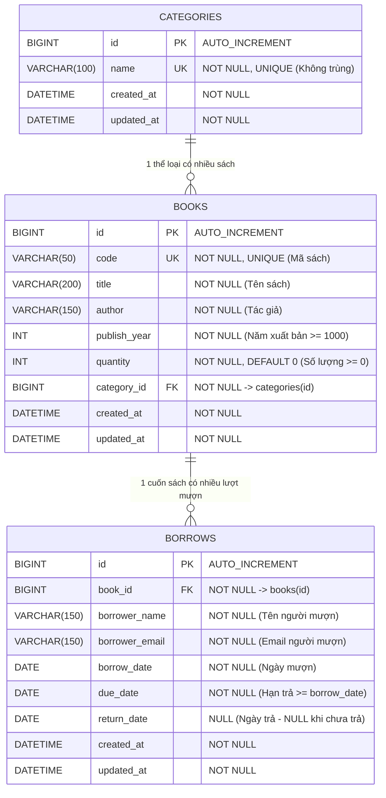
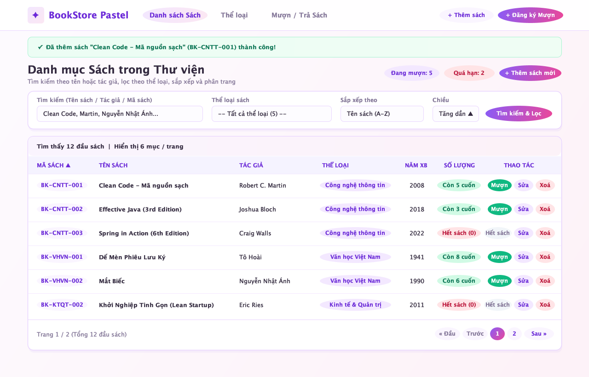
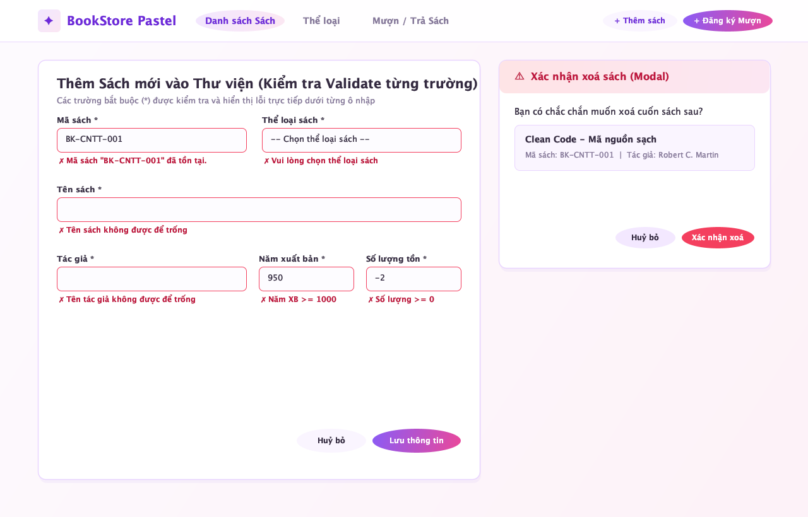
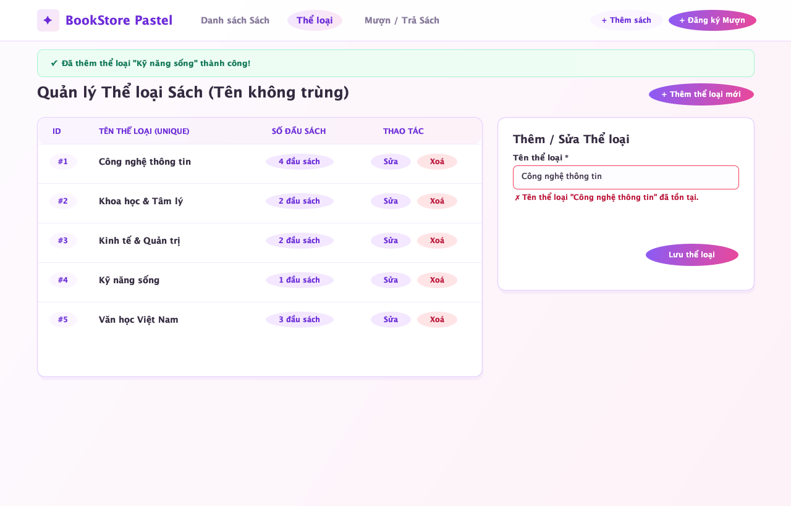
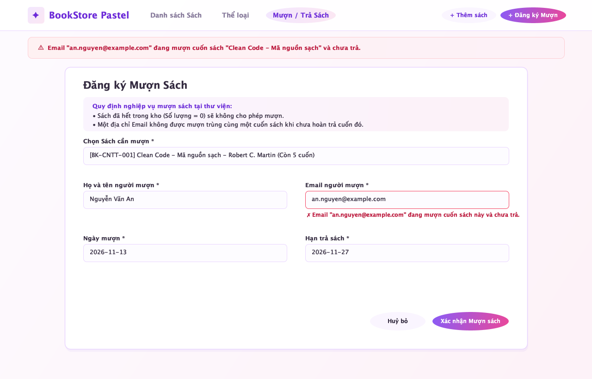
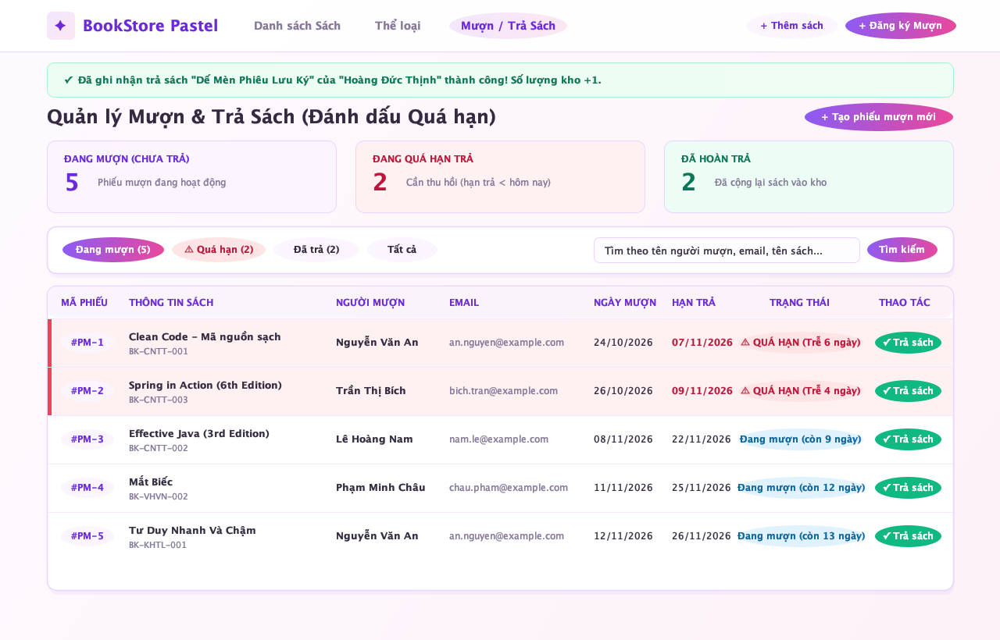
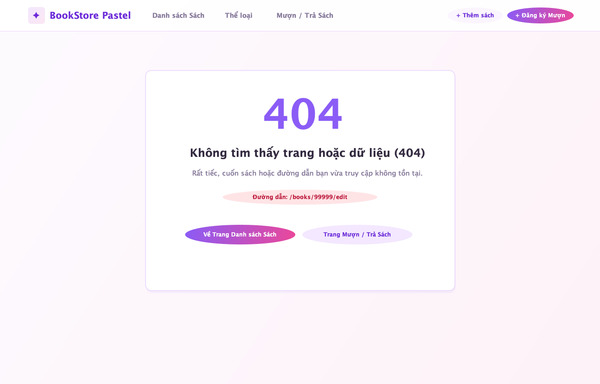

# Hệ thống Quản lý Sách & Mượn Trả Thư viện (Book Store & Library Management)

Ứng dụng web quản lý danh mục sách, thể loại sách và nghiệp vụ mượn/trả sách được xây dựng bằng **Java 17**, **Spring Boot 3**, **Spring MVC + Thymeleaf (Server-Side Rendering)**, **Spring Data JPA** và **MySQL**.

---

## 1. Công nghệ sử dụng

| Thành phần | Công nghệ / Phiên bản |
| :--- | :--- |
| **Ngôn ngữ** | Java 17 |
| **Framework chính** | Spring Boot 3.4.3 (`spring-boot-starter-web`, `spring-boot-starter-validation`) |
| **Template Engine** | Thymeleaf (Server-Side Rendering) + Bootstrap 5.3 + Bootstrap Icons |
| **ORM & Truy vấn CSDL** | Spring Data JPA / Hibernate 6 |
| **Cơ sở dữ liệu** | MySQL 8.0+ (H2 in-memory hỗ trợ chạy Unit/Integration Test độc lập) |
| **Kiểm thử (Unit Test)** | JUnit 5 (Jupiter) + Mockito (`13 unit tests` cho tầng Service) |
| **Công cụ Build** | Gradle (Gradle Wrapper `./gradlew`) |

---

## 2. Thiết kế Cơ sở dữ liệu & Truy vấn (Tiêu chí 3)

### 2.1. Sơ đồ quan hệ thực thể (ERD)



### 2.2. Script tạo bảng (`sql/schema.sql`)

Toàn bộ script khởi tạo bảng và dữ liệu mẫu được đặt tại:
- Script tạo bảng (DDL): [`sql/schema.sql`](sql/schema.sql)
- Script dữ liệu mẫu (DML): [`sql/sample_data.sql`](sql/sample_data.sql)

```sql
CREATE DATABASE IF NOT EXISTS book_store_db
    CHARACTER SET utf8mb4
    COLLATE utf8mb4_unicode_ci;

USE book_store_db;

-- 1. Bảng categories (Thể loại sách - tên không trùng)
CREATE TABLE IF NOT EXISTS categories (
    id BIGINT AUTO_INCREMENT PRIMARY KEY,
    name VARCHAR(100) NOT NULL,
    created_at DATETIME NOT NULL DEFAULT CURRENT_TIMESTAMP,
    updated_at DATETIME NOT NULL DEFAULT CURRENT_TIMESTAMP ON UPDATE CURRENT_TIMESTAMP,
    CONSTRAINT uk_categories_name UNIQUE (name)
) ENGINE=InnoDB DEFAULT CHARSET=utf8mb4 COLLATE=utf8mb4_unicode_ci;

-- 2. Bảng books (Sách)
CREATE TABLE IF NOT EXISTS books (
    id BIGINT AUTO_INCREMENT PRIMARY KEY,
    code VARCHAR(50) NOT NULL,
    title VARCHAR(200) NOT NULL,
    author VARCHAR(150) NOT NULL,
    publish_year INT NOT NULL,
    quantity INT NOT NULL DEFAULT 0,
    category_id BIGINT NOT NULL,
    created_at DATETIME NOT NULL DEFAULT CURRENT_TIMESTAMP,
    updated_at DATETIME NOT NULL DEFAULT CURRENT_TIMESTAMP ON UPDATE CURRENT_TIMESTAMP,
    CONSTRAINT uk_books_code UNIQUE (code),
    CONSTRAINT chk_books_quantity CHECK (quantity >= 0),
    CONSTRAINT chk_books_publish_year CHECK (publish_year >= 1000),
    CONSTRAINT fk_books_category FOREIGN KEY (category_id)
        REFERENCES categories (id)
        ON UPDATE CASCADE
        ON DELETE RESTRICT,
    INDEX idx_books_category_id (category_id),
    INDEX idx_books_title (title),
    INDEX idx_books_author (author),
    INDEX idx_books_publish_year (publish_year)
) ENGINE=InnoDB DEFAULT CHARSET=utf8mb4 COLLATE=utf8mb4_unicode_ci;

-- 3. Bảng borrows (Phiếu mượn sách)
CREATE TABLE IF NOT EXISTS borrows (
    id BIGINT AUTO_INCREMENT PRIMARY KEY,
    book_id BIGINT NOT NULL,
    borrower_name VARCHAR(150) NOT NULL,
    borrower_email VARCHAR(150) NOT NULL,
    borrow_date DATE NOT NULL,
    due_date DATE NOT NULL,
    return_date DATE NULL,
    created_at DATETIME NOT NULL DEFAULT CURRENT_TIMESTAMP,
    updated_at DATETIME NOT NULL DEFAULT CURRENT_TIMESTAMP ON UPDATE CURRENT_TIMESTAMP,
    CONSTRAINT chk_borrows_dates CHECK (due_date >= borrow_date),
    CONSTRAINT fk_borrows_book FOREIGN KEY (book_id)
        REFERENCES books (id)
        ON UPDATE CASCADE
        ON DELETE RESTRICT,
    INDEX idx_borrows_book_email_return (book_id, borrower_email, return_date),
    INDEX idx_borrows_return_due (return_date, due_date),
    INDEX idx_borrows_borrower_email (borrower_email)
) ENGINE=InnoDB DEFAULT CHARSET=utf8mb4 COLLATE=utf8mb4_unicode_ci;
```

### 2.3. Tối ưu hóa Truy vấn & Chống lỗi N+1 Query

1. **Tắt Open Session In View (`spring.jpa.open-in-view=false`)** và sử dụng **`@EntityGraph`**:
   - Trong `BookRepository.searchBooks(...)`: sử dụng `@EntityGraph(attributePaths = {"category"})` để nạp sẵn `Category` cùng truy vấn phân trang `Page<Book>`, loại bỏ hoàn toàn lỗi $N+1$ query khi hiển thị tên thể loại trên trang danh sách sách.
   - Trong `BorrowRepository.searchBorrows(...)`: sử dụng `@EntityGraph(attributePaths = {"book", "book.category"})` để lấy toàn bộ thông tin `Borrow` + `Book` + `Category` chỉ trong 1 câu truy vấn `JOIN`.
2. **Đánh chỉ mục (Indexing) phục vụ nghiệp vụ cốt lõi**:
   - `idx_borrows_book_email_return (book_id, borrower_email, return_date)`: tăng tốc truy vấn `existsByBookIdAndBorrowerEmailIgnoreCaseAndReturnDateIsNull` dùng để kiểm tra một email không mượn trùng cùng một cuốn khi chưa trả.
   - `idx_borrows_return_due (return_date, due_date)`: tối ưu hóa lọc danh sách đang mượn (`return_date IS NULL`) và đánh dấu/lọc quá hạn (`due_date < CURRENT_DATE`).
   - `idx_books_category_id`, `idx_books_title`, `idx_books_author`: tối ưu hóa tìm kiếm, lọc theo thể loại và sắp xếp sách.
3. **Truy vấn gộp (Projection Query) cho trang Thể loại**:
   - Sử dụng câu lệnh JPQL `SELECT new com.example.bookstore.dto.CategorySummaryDto(c.id, c.name, COUNT(b.id), c.createdAt) FROM Category c LEFT JOIN c.books b GROUP BY ...` để đếm số lượng đầu sách của từng thể loại trong một truy vấn duy nhất.

---

## 3. Cấu trúc Code và Áp dụng OOP (Tiêu chí 2)

### 3.1. Cấu trúc thư mục dự án

```text
book-store/
├── sql/
│   ├── schema.sql                       # Script DDL tạo CSDL, bảng, ràng buộc và index
│   └── sample_data.sql                  # Script DML thêm dữ liệu mẫu (còn sách, hết sách, quá hạn, đã trả)
├── docs/
│   └── screenshots/                     # Ảnh chụp giao diện các trang chức năng
├── src/
│   ├── main/
│   │   ├── java/com/example/bookstore/
│   │   │   ├── BookStoreApplication.java
│   │   │   ├── config/
│   │   │   │   └── DataInitializer.java # Tự động khởi tạo dữ liệu mẫu khi DB trống
│   │   │   ├── controller/              # Tầng Presentation (Spring MVC Controllers)
│   │   │   │   ├── HomeController.java
│   │   │   │   ├── BookController.java
│   │   │   │   ├── CategoryController.java
│   │   │   │   ├── BorrowController.java
│   │   │   │   └── CustomErrorController.java
│   │   │   ├── dto/                     # Data Transfer Objects & Bean Validation
│   │   │   │   ├── BookFormDto.java
│   │   │   │   ├── BookSearchCriteria.java
│   │   │   │   ├── CategoryFormDto.java
│   │   │   │   ├── CategorySummaryDto.java
│   │   │   │   └── BorrowFormDto.java
│   │   │   ├── entity/                  # Domain Entities (JPA + Domain Methods)
│   │   │   │   ├── BaseEntity.java
│   │   │   │   ├── Category.java
│   │   │   │   ├── Book.java
│   │   │   │   └── Borrow.java
│   │   │   ├── exception/               # Xử lý ngoại lệ tập trung
│   │   │   │   ├── BusinessException.java
│   │   │   │   ├── DuplicateResourceException.java
│   │   │   │   ├── ResourceNotFoundException.java
│   │   │   │   └── GlobalExceptionHandler.java
│   │   │   ├── repository/              # Tầng Data Access (Spring Data JPA)
│   │   │   │   ├── CategoryRepository.java
│   │   │   │   ├── BookRepository.java
│   │   │   │   └── BorrowRepository.java
│   │   │   └── service/                 # Tầng Business Logic (Interfaces & Implementations)
│   │   │       ├── CategoryService.java
│   │   │       ├── BookService.java
│   │   │       ├── BorrowService.java
│   │   │       └── impl/
│   │   │           ├── CategoryServiceImpl.java
│   │   │           ├── BookServiceImpl.java
│   │   │           └── BorrowServiceImpl.java
│   │   └── resources/
│   │       ├── application.properties
│   │       ├── static/css/style.css
│   │       └── templates/               # Giao diện Thymeleaf (Server-side rendering)
│   │           ├── fragments/layout.html
│   │           ├── books/{list,form}.html
│   │           ├── categories/{list,form}.html
│   │           ├── borrows/{list,form}.html
│   │           └── error/{404,500}.html
│   └── test/
│       └── java/com/example/bookstore/
│           └── service/                 # 13 Unit Tests cho tầng Service
│               ├── BorrowServiceTest.java
│               ├── BookServiceTest.java
│               └── CategoryServiceTest.java
└── build.gradle
```

### 3.2. Các nguyên lý OOP được áp dụng

1. **Tính Kế thừa (Inheritance)**:
   - Lớp trừu tượng `BaseEntity` (`@MappedSuperclass`) định nghĩa định danh `id`, thời gian tạo `createdAt`, thời gian cập nhật `updatedAt` cùng các phương thức vòng đời `@PrePersist`, `@PreUpdate` và `equals`/`hashCode`. Các thực thể `Category`, `Book`, `Borrow` kế thừa từ `BaseEntity` giúp tái sử dụng mã nguồn.
   - Cây phân cấp ngoại lệ: `DuplicateResourceException` kế thừa từ `BusinessException`, giúp tầng Controller bắt và gắn lỗi chính xác vào từng trường (`fieldName`) trên `BindingResult`.
2. **Tính Đóng gói & Rich Domain Model (Encapsulation)**:
   - Các thuộc tính trong Entity đều là `private` và chuẩn hóa dữ liệu đầu vào (ví dụ: `code` tự động in hoa và cắt khoảng trắng, `borrowerEmail` tự động chuyển chữ thường).
   - Các hành vi nghiệp vụ cốt lõi được đóng gói ngay trong đối tượng miền (Domain Entity):
     - `Book.isAvailable()`, `Book.borrowOne()`, `Book.returnOne()`: kiểm soát chặt chẽ việc tăng/giảm số lượng tồn kho, ngăn chặn trạng thái tồn kho âm.
     - `Borrow.isReturned()`, `Borrow.isOverdue()`, `Borrow.getOverdueDays()`, `Borrow.markReturned(LocalDate)`: đóng gói logic kiểm tra quá hạn và hoàn trả sách.
3. **Tính Trừu tượng & Đa hình (Abstraction & Polymorphism)**:
   - Tầng Controller chỉ phụ thuộc vào các Interface (`BookService`, `CategoryService`, `BorrowService`) thông qua Constructor Injection thay vì phụ thuộc vào lớp thực thi cụ thể (`*ServiceImpl`), tuân thủ nguyên lý **Dependency Inversion (SOLID)**.

---

## 4. Ảnh chụp Giao diện các Trang chức năng (Tiêu chí 1 & 4)

### 4.1. Trang Danh sách Sách (Tìm kiếm, Lọc thể loại, Sắp xếp, Phân trang)
- Tìm theo tên sách, tác giả hoặc mã sách; lọc theo thể loại; sắp xếp tăng/giảm theo nhiều tiêu chí; phân trang đầy đủ.
- Sách có `Số lượng = 0` hiển thị trạng thái **Hết sách (0)** và vô hiệu hóa nút mượn.



### 4.2. Form Thêm / Sửa Sách & Validate lỗi từng trường, Xoá có xác nhận
- Kiểm tra dữ liệu đầu vào (`@NotBlank`, `@Min`, `@Max`, `@Pattern`) và kiểm tra trùng mã sách, hiển thị lỗi chi tiết ngay bên dưới từng ô nhập liệu.
- Xoá sách và xoá thể loại đều có hộp thoại Modal xác nhận trước khi thực hiện.



### 4.3. Trang Quản lý Thể loại Sách (Không trùng tên)
- Hiển thị danh sách thể loại kèm số lượng đầu sách thuộc mỗi thể loại.
- Kiểm tra không trùng tên thể loại khi thêm/sửa và bảo vệ không cho xoá thể loại đang chứa sách.



### 4.4. Form Mượn Sách (Chặn mượn khi hết sách & Chặn 1 Email mượn trùng khi chưa trả)
- Kiểm tra 2 quy tắc nghiệp vụ quan trọng:
  1. **Hết sách thì không cho mượn** (`quantity <= 0`).
  2. **Một email không được mượn trùng cùng một cuốn sách khi chưa trả** (`return_date IS NULL`).



### 4.5. Trang Danh sách Đang mượn, Đánh dấu Quá hạn & Trả sách
- Tô màu cảnh báo đỏ và gắn nhãn **`QUÁ HẠN (Trễ X ngày)`** cho các phiếu chưa trả có `hạn trả < ngày hiện tại`.
- Cho phép lọc theo các tab: **Đang mượn**, **Quá hạn**, **Đã trả**, **Tất cả**, và thực hiện **Trả sách** (cộng lại số lượng sách vào kho) kèm thông báo thành công.



### 4.6. Trang Lỗi 404 Thân thiện
- Khi người dùng truy cập đường dẫn không tồn tại hoặc ID sách/thể loại/phiếu mượn không có trong CSDL, hệ thống hiển thị trang 404 thân thiện bằng tiếng Việt kèm nút quay về trang chủ.



---

## 5. Hướng dẫn Cài đặt & Cách chạy Ứng dụng

### 5.1. Yêu cầu hệ thống
- **JDK 17** trở lên
- **MySQL Server 8.0+** đang chạy tại cổng `3306`

### 5.2. Bước 1: Khởi tạo Cơ sở dữ liệu MySQL

**Cách 1 (Tự động):**
Ứng dụng đã cấu hình `createDatabaseIfNotExist=true`, `spring.jpa.hibernate.ddl-auto=update` và `DataInitializer`. Khi chạy ứng dụng lần đầu, hệ thống sẽ **tự động tạo database `book_store_db`, tạo các bảng và nạp sẵn dữ liệu mẫu** (5 thể loại, 12 đầu sách, 7 phiếu mượn gồm cả phiếu đang mượn, quá hạn và đã trả).

**Cách 2 (Chạy script SQL thủ công):**
```bash
mysql -u root -p < sql/schema.sql
mysql -u root -p < sql/sample_data.sql
```

### 5.3. Bước 2: Cấu hình kết nối MySQL
Mặc định trong [`src/main/resources/application.properties`](src/main/resources/application.properties):
- URL: `jdbc:mysql://localhost:3306/book_store_db?createDatabaseIfNotExist=true...`
- Username: `root`
- Password: *(để trống hoặc truyền qua biến môi trường `DB_PASSWORD`)*

Bạn có thể chỉnh trực tiếp trong `src/main/resources/application.properties` hoặc truyền biến môi trường khi chạy:
```bash
export DB_USERNAME=root
export DB_PASSWORD=your_mysql_password
```

### 5.4. Bước 3: Chạy ứng dụng

```bash
./gradlew bootRun
```
Sau khi khởi động, mở trình duyệt truy cập:
- Trang danh sách sách: http://localhost:8080/books
- Trang quản lý thể loại: http://localhost:8080/categories
- Trang danh sách đang mượn & trả sách: http://localhost:8080/borrows
- Trang đăng ký mượn sách: http://localhost:8080/borrows/new

---

## 6. Chạy Unit Test tầng Service (Yêu cầu 6)

Dự án bao gồm **13 Unit Tests** (vượt yêu cầu tối thiểu 5 unit tests) sử dụng **JUnit 5 + Mockito** kiểm thử toàn diện tầng Service:

1. `BorrowServiceTest` (6 unit tests):
   - Mượn sách thành công (giảm số lượng tồn kho đi 1, lưu phiếu mượn).
   - Mượn sách thất bại khi sách đã hết (`quantity == 0`).
   - Mượn sách thất bại khi cùng một email mượn trùng cuốn sách chưa trả.
   - Mượn sách thất bại khi hạn trả nhỏ hơn ngày mượn.
   - Trả sách thành công (cập nhật `returnDate` và tăng số lượng sách lên 1).
   - Trả sách thất bại khi phiếu mượn đã được trả trước đó.
2. `BookServiceTest` (4 unit tests):
   - Thêm sách thành công khi mã sách không trùng.
   - Thêm sách thất bại khi mã sách đã tồn tại.
   - Xoá sách thất bại khi sách đang được mượn chưa trả.
   - Tìm kiếm, lọc theo thể loại và phân trang danh sách sách.
3. `CategoryServiceTest` (3 unit tests):
   - Thêm thể loại thành công khi tên không trùng.
   - Thêm thể loại thất bại khi tên thể loại bị trùng.
   - Xoá thể loại thất bại khi thể loại đang có sách.

Chạy toàn bộ Unit Test bằng lệnh:
```bash
./gradlew test
```

